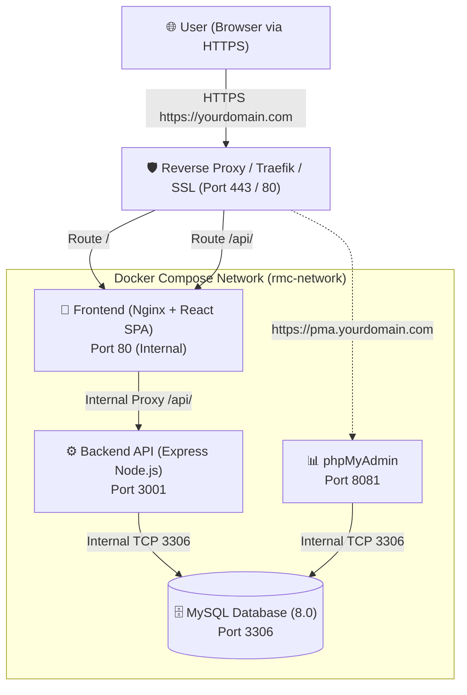

# 🚀 Weighbridge RMC — Docker & Server Deployment Guide

This guide details the complete deployment setup for the **Weighbridge RMC** application using **Docker Compose** (Coolify, VPS, or dedicated server), including Frontend, Backend, MySQL database, phpMyAdmin, HTTPS domains, and CORS configuration.

---

## 🏗️ Architecture Overview



---

## 📦 Services in `docker-compose.yml`

| Service | Image / Build | Port Mapping | Purpose |
| :--- | :--- | :--- | :--- |
| **`frontend`** | Multi-stage build (`Dockerfile` + Nginx) | `80:80` | Serves Vite React SPA, proxies `/api/` to backend |
| **`backend`** | `server/Dockerfile` (Node 20-alpine) | `3001:3001` | Express REST API, auth, ANPR, camera, weighbridge |
| **`database`** | `mysql:8.0` | `3306:3306` | MySQL server with persistent volume & auto-init SQL |
| **`phpmyadmin`** | `phpmyadmin:latest` | `8081:80` | Web UI for database management & inspection |

---

## 🔒 CORS & HTTPS Fixes Implemented

1. **Mixed Content Elimination**:
   - The frontend API client (`src/lib/api.ts`) defaults to `/api` in browser environments.
   - When deployed over HTTPS (`https://yourdomain.com`), requests to `/api/*` are made over HTTPS to the same domain.
   - Nginx internally forwards `/api/*` to `http://backend:3001/api/*`.
   - **No mixed content warnings, no cross-port blocks.**

2. **Dynamic CORS with Credential Support**:
   - Backend Express server has `app.set('trust proxy', 1)` to trust HTTPS headers from Traefik/Coolify/Cloudflare.
   - Dynamic origin reflection: Rather than static `*` (which browsers block when credentials/tokens are sent), the origin header is mirrored with `Access-Control-Allow-Credentials: true`.
   - Preflight `OPTIONS` requests immediately return `204 No Content` with complete allowed headers (`Authorization`, `Content-Type`, `X-Plant-Id`, etc.).

---

## 🚀 How to Deploy on Server (Coolify / VPS)

### Option A: Deploy via Coolify (Compose Build Pack)

1. **Repository Settings**:
   - Set Build Pack to: **Docker Compose**
   - Compose file location: `docker-compose.yml`
2. **Environment Variables**:
   In Coolify Environment settings, set:
   ```env
   DB_USER=root
   DB_PASSWORD=root
   DB_NAME=rmc_gate_system
   CORS_ORIGIN=*
   ```
3. **Domains**:
   - Assign your primary HTTPS domain to the `frontend` service (e.g. `https://rmc.yourdomain.com`).
   - (Optional) Assign a subdomain to `phpmyadmin` (e.g. `https://pma.yourdomain.com`).
4. Click **Deploy**.
   - Docker will build the frontend and backend, spin up MySQL, automatically execute `docker/mysql/init.sql` (creating all 38 tables and seed data), and start phpMyAdmin.

---

### Option B: Deploy Manually on VPS / Ubuntu Server

```bash
# 1. Clone repository
git clone <your-repo-url>
cd Weighbridge_RMC_Project

# 2. Copy environment file
cp .env.docker.example .env

# 3. Build and launch containers
docker compose up -d --build

# 4. Check container status
docker compose ps

# 5. View backend logs
docker compose logs -f backend
```

---

## 🔑 Default Credentials

- **Web Application**:
  - URL: `http://localhost:8080` (Local) or `https://yourdomain.com` (Production)
  - Username: `admin`
  - Password: `admin123`
- **phpMyAdmin**:
  - URL: `http://<server-ip>:8081` or `https://pma.yourdomain.com`
  - Server: `database` (pre-configured)
  - Username: `root`
  - Password: `root` (or the `DB_PASSWORD` set in `.env`)
